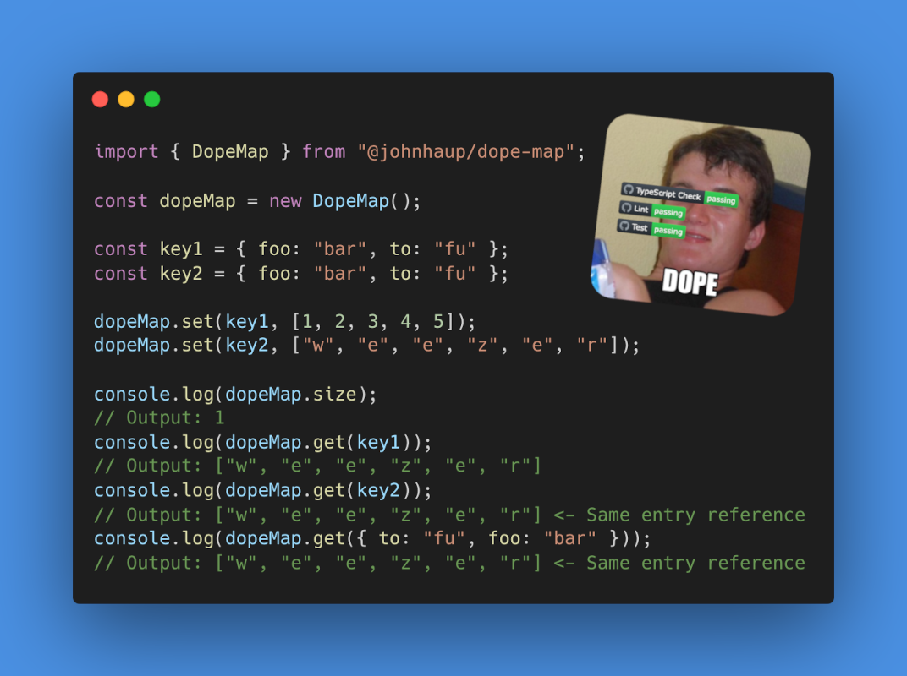
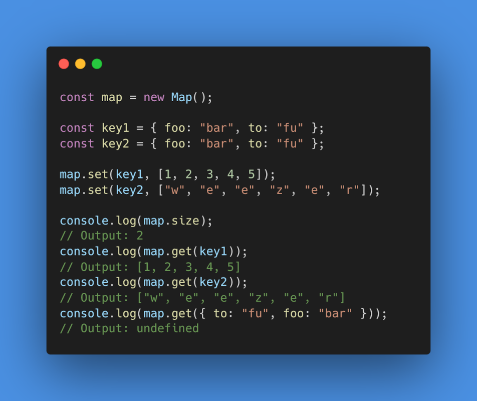

<div align="center">
  <a href="https://youtu.be/lgErexMUTC0?si=e5aRXD95TYwhgihG">
    
  </a>
</div>

# dope-map

A wrapper around [Map](https://developer.mozilla.org/en-US/docs/Web/JavaScript/Reference/Global_Objects/Map) that uses structural equality for key matching instead of the [SameValueZero algorithm](https://developer.mozilla.org/en-US/docs/Web/JavaScript/Reference/Global_Objects/Map#key_equality). This means that (for example) objects of equal but not referential value will point to the same `DopeMap` entry. This can come with a slight performance tradeoff (see [Benchmarks](#benchmarks)), so if your dataset is very large take that into consideration.

Ships with a dep-free hashing function: keys are serialized with stable (sorted) JSON and reduced to a 53-bit [FNV-1a](https://en.wikipedia.org/wiki/Fowler%E2%80%93Noll%E2%80%93Vo_hash_function)-style integer. You can supply a different hashing function in DopeMap's config (as long as it returns a `string` or `number`).

fafo [here](https://johnhaup.github.io/dope-map)

## Installation

```bash
yarn add @johnhaup/dope-map
```

## Comparison

<div>
    
    
</div>

## API Reference

_In addition to standard Map methods_

#### Config

DopeMaps constructor accepts a second `config` argument.

```javascript
import { DopeMap } from "@johnhaup/dope-map";
import hashIt from "hash-it";

const dopeMap = new DopeMap(null, { hashFunction: hashIt });
```

| Property       | Type                                 | Description                                     |
| -------------- | ------------------------------------ | ----------------------------------------------- |
| `hashFunction` | `(key: unknown) => string \| number` | Custom hashing function for non-primitive keys. |

#### Methods

| Method       | Return Value                                     |
| ------------ | ------------------------------------------------ |
| `getEntries` | Array of `[key, value]` tuples in order of entry |
| `getKeys`    | Array of keys in order of entry                  |
| `getValues`  | Array of values in order of entry                |

### Typescript

`DopeMap's` generics are flipped from traditional `Map`:

```typescript
DopeMap<Value, Key = unknown> // Map<Key = any, Value = any>
```

Key is optional so you can just type the value and go crazy with the keys you pass.

## Examples

#### API Cache

```javascript
import { DopeMap } from "@johnhaup/dope-map";

const apiCache = new DopeMap();

const filters = {
  category: "electronics",
  priceRange: [100, 500],
  tags: ["sale"],
};

async function fetchProducts(query) {
  if (apiCache.has(query)) {
    console.log("Cache hit");
    return apiCache.get(query);
  }

  console.log("Cache miss");
  const response = await fetch(`/api/products?${new URLSearchParams(query)}`);
  const data = await response.json();

  apiCache.set(query, data);
  return data;
}

await fetchProducts(filters);
await fetchProducts({
  priceRange: [100, 500],
  category: "electronics",
  tags: ["sale"],
}); // <- Cache hit
```

#### Product Lookup

```typescript
import { DopeMap } from "@johnhaup/dope-map";

type ProductAttributes = {
  color: string;
  size: string;
  material: string;
};

type Product = {
  id: string;
  price: number;
  promoPrice: number | null;
  title: string;
};

const initialEntries: [ProductAttributes, Product][] = [
  [
    { color: "blue", size: "sm", material: "cotton" },
    { id: "13nl54l", title: "Cool Blue", price: 24.99, promoPrice: null },
  ],
  [
    { color: "blue", size: "xs", material: "cotton" },
    { id: "909sadfj", title: "Cool Blue", price: 19.99, promoPrice: 9.99 },
  ],
];

const productMap = new DopeMap<Product>(initialEntries);

interface Props {
  filters: Partial<ProductAttributes>;
}

function SelectedProduct({ filters }: Props) {
  const product = useMemo(() => {
    return productMap.get(filters);
  }, [filters]);

  if (!product) {
    return null;
  }

  return (
    <div>
      <p>{product.title}</p>
      <p>{product.price}</p>
      <p>{product.promoPrice}</p>
    </div>
  );
}
```

## Benchmarks

_Each Dope/Map grows to the iteration size. Averages of method time are below. All times are in milliseconds._

<!-- BENCHMARK RESULTS START -->
### OBJECTS keys
#### 100 entries
| Map | Set | Get | Has | Delete | Clear |
|-----------|-----------|-----------|-----------|-----------|----------- |
| **Map** | 0.005 | 0.001 | 0.001 | 0.005 | 0.005 |
| **DopeMap** | 0.069 (+0.064) | 0.005 (+0.004) | 0.003 (+0.002) | 0.131 (+0.126) | 0.099 (+0.094) |
| **DopeMap w/hash-it** | 0.065 (+0.061) | 0.004 (+0.003) | 0.003 (+0.002) | 0.092 (+0.087) | 0.092 (+0.087) |

#### 1,000 entries
| Map | Set | Get | Has | Delete | Clear |
|-----------|-----------|-----------|-----------|-----------|----------- |
| **Map** | 0.024 | 0.016 | 0.012 | 0.051 | 0.024 |
| **DopeMap** | 0.581 (+0.558) | 0.058 (+0.042) | 0.030 (+0.018) | 0.569 (+0.519) | 0.584 (+0.559) |
| **DopeMap w/hash-it** | 0.711 (+0.688) | 0.053 (+0.037) | 0.026 (+0.014) | 0.656 (+0.606) | 0.606 (+0.581) |

#### 10,000 entries
| Map | Set | Get | Has | Delete | Clear |
|-----------|-----------|-----------|-----------|-----------|----------- |
| **Map** | 0.275 | 0.072 | 0.072 | 0.507 | 0.299 |
| **DopeMap** | 5.2 (+4.9) | 0.604 (+0.531) | 0.283 (+0.212) | 6.7 (+6.2) | 6.0 (+5.7) |
| **DopeMap w/hash-it** | 7.3 (+7.0) | 0.725 (+0.653) | 0.321 (+0.250) | 8.1 (+7.6) | 6.8 (+6.5) |

#### 100,000 entries
| Map | Set | Get | Has | Delete | Clear |
|-----------|-----------|-----------|-----------|-----------|----------- |
| **Map** | 4.1 | 0.840 | 0.768 | 7.5 | 4.4 |
| **DopeMap** | 79.1 (+74.9) | 7.8 (+7.0) | 3.0 (+2.3) | 93.8 (+86.3) | 69.7 (+65.3) |
| **DopeMap w/hash-it** | 79.7 (+75.5) | 6.4 (+5.6) | 2.7 (+1.9) | 89.6 (+82.1) | 83.2 (+78.8) |

### PRIMITIVES keys
#### 100 entries
| Map | Set | Get | Has | Delete | Clear |
|-----------|-----------|-----------|-----------|-----------|----------- |
| **Map** | 0.003 | 0.001 | 0.001 | 0.005 | 0.003 |
| **DopeMap** | 0.003 (+0.001) | 0.003 (+0.002) | 0.002 (+0.001) | 0.008 (+0.003) | 0.006 (+0.003) |
| **DopeMap w/hash-it** | 0.011 (+0.008) | 0.010 (+0.009) | 0.005 (+0.004) | 0.025 (+0.020) | 0.012 (+0.009) |

#### 1,000 entries
| Map | Set | Get | Has | Delete | Clear |
|-----------|-----------|-----------|-----------|-----------|----------- |
| **Map** | 0.127 | 0.034 | 0.026 | 0.097 | 0.042 |
| **DopeMap** | 0.069 (-0.058) | 0.097 (+0.063) | 0.035 (+0.009) | 0.215 (+0.118) | 0.123 (+0.081) |
| **DopeMap w/hash-it** | 0.135 (+0.008) | 0.206 (+0.172) | 0.037 (+0.012) | 0.224 (+0.127) | 0.101 (+0.059) |

#### 10,000 entries
| Map | Set | Get | Has | Delete | Clear |
|-----------|-----------|-----------|-----------|-----------|----------- |
| **Map** | 2.0 | 0.328 | 0.307 | 3.1 | 1.9 |
| **DopeMap** | 1.9 (-0.108) | 1.2 (+0.864) | 0.458 (+0.151) | 4.2 (+1.1) | 2.3 (+0.448) |
| **DopeMap w/hash-it** | 2.3 (+0.255) | 1.5 (+1.2) | 0.440 (+0.132) | 4.1 (+1.0) | 2.6 (+0.763) |

#### 100,000 entries
| Map | Set | Get | Has | Delete | Clear |
|-----------|-----------|-----------|-----------|-----------|----------- |
| **Map** | 35.2 | 3.8 | 4.2 | 55.2 | 26.6 |
| **DopeMap** | 26.0 (-9.1) | 15.5 (+11.6) | 2.1 (-2.1) | 41.3 (-13.9) | 27.7 (+1.1) |
| **DopeMap w/hash-it** | 33.7 (-1.4) | 22.8 (+19.0) | 3.6 (-0.594) | 62.1 (+6.9) | 21.4 (-5.2) |

### Real-World Patterns

#### Read-Heavy (70% Get, 20% Set, 5% Has, 5% Delete) - objects keys, 10,000 entries
| Map | Avg Time (ms) |
|-----------|-----------|
| **Map** | 0.419 |
| **DopeMap** | 2.3 (+1.9) |
| **DopeMap w/hash-it** | 1.9 (+1.4) |

#### Write-Heavy (50% Set, 30% Get, 10% Has, 10% Delete) - objects keys, 10,000 entries
| Map | Avg Time (ms) |
|-----------|-----------|
| **Map** | 0.496 |
| **DopeMap** | 2.2 (+1.7) |
| **DopeMap w/hash-it** | 1.2 (+0.662) |

#### Read-Heavy (70% Get, 20% Set, 5% Has, 5% Delete) - primitives keys, 10,000 entries
| Map | Avg Time (ms) |
|-----------|-----------|
| **Map** | 1.1 |
| **DopeMap** | 1.2 (+0.106) |
| **DopeMap w/hash-it** | 0.816 (-0.273) |

#### Write-Heavy (50% Set, 30% Get, 10% Has, 10% Delete) - primitives keys, 10,000 entries
| Map | Avg Time (ms) |
|-----------|-----------|
| **Map** | 0.491 |
| **DopeMap** | 0.683 (+0.192) |
| **DopeMap w/hash-it** | 0.767 (+0.276) |

### Memory Usage

#### 1,000 entries - objects keys
| Map | Populated | After Clear | Freed |
|-----------|-----------|-----------|-----------|
| **Map** | -133.2 KB | -161.0 KB | 27.8 KB |
| **DopeMap** | 103.2 KB | -1.2 KB | 104.4 KB |
| **DopeMap w/hash-it** | 97.7 KB | 1.0 KB | 96.7 KB |

#### 10,000 entries - objects keys
| Map | Populated | After Clear | Freed |
|-----------|-----------|-----------|-----------|
| **Map** | 222.9 KB | -488 B | 223.3 KB |
| **DopeMap** | 939.0 KB | 80.8 KB | 858.2 KB |
| **DopeMap w/hash-it** | 860.0 KB | 2.2 KB | 857.8 KB |

#### 100,000 entries - objects keys
| Map | Populated | After Clear | Freed |
|-----------|-----------|-----------|-----------|
| **Map** | 3.50 MB | -1.0 KB | 3.50 MB |
| **DopeMap** | 11.77 MB | 786.7 KB | 11.01 MB |
| **DopeMap w/hash-it** | 11.01 MB | 3.9 KB | 11.01 MB |

#### 1,000 entries - primitives keys
| Map | Populated | After Clear | Freed |
|-----------|-----------|-----------|-----------|
| **Map** | 24.6 KB | -3.2 KB | 27.8 KB |
| **DopeMap** | 67.5 KB | 4.3 KB | 63.2 KB |
| **DopeMap w/hash-it** | 66.2 KB | 2.9 KB | 63.3 KB |

#### 10,000 entries - primitives keys
| Map | Populated | After Clear | Freed |
|-----------|-----------|-----------|-----------|
| **Map** | 446.4 KB | -1.6 KB | 447.9 KB |
| **DopeMap** | 842.9 KB | 4.5 KB | 838.4 KB |
| **DopeMap w/hash-it** | 841.3 KB | 2.8 KB | 838.4 KB |

#### 100,000 entries - primitives keys
| Map | Populated | After Clear | Freed |
|-----------|-----------|-----------|-----------|
| **Map** | 3.50 MB | -160 B | 3.50 MB |
| **DopeMap** | 7.32 MB | 4.2 KB | 7.31 MB |
| **DopeMap w/hash-it** | 7.32 MB | 4.1 KB | 7.31 MB |

<!-- BENCHMARK RESULTS END -->
